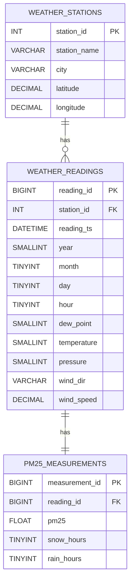

# Entity Relationship Diagram — Beijing PM2.5 SQL Schema

## Design Rationale

| Decision | Reason |
|---|---|
| `weather_stations` separated | Allows multiple stations to be added without schema changes |
| `weather_readings` separated from `pm25_measurements` | Weather sensors and PM2.5 sensors can fail independently; NULL handling is cleaner in a dedicated table |
| `reading_ts` DATETIME + UNIQUE constraint | Prevents duplicate hourly entries per station |
| `pm25` stored as FLOAT (nullable) | Preserves the original NA values as SQL NULL rather than a sentinel value |
| Index on `reading_ts` | Optimises the date-range queries required by Task 3 |
